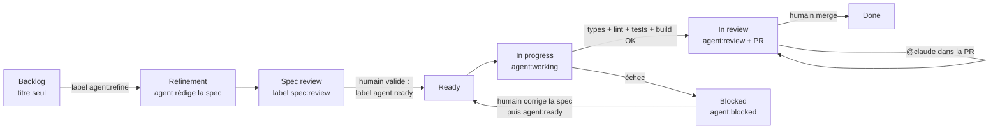

# Workflow agentique : des issues au board, du ticket à la PR

Les issues GitHub servent de specs. Un agent Claude (via
[`anthropics/claude-code-action`](https://github.com/anthropics/claude-code-action))
les transforme en spécifications, les implémente une par une et ouvre une pull
request. **Rien n'est mergé sans validation humaine.**

Même fonctionnement que sur `fanfiction-front-vue`, `microfrontend`,
`angular-ssr-taiwan` et `angular-qrcode-restaurant`, adapté à une PWA React
**sans backend** (voir la dernière section).

## Cycle de vie d'un ticket

| Étape | Qui | Déclencheur | Ce qui se passe |
| --- | --- | --- | --- |
| Raffinement | Agent | label `agent:refine` (ou lancement manuel sur une liste d'issues / une épic entière) | L'agent lit le ticket, l'épic parente, les tickets voisins et le code, puis remplace le corps de l'issue par une spec (contexte, critères d'acceptation, impact technique — composants, données Dexie, services externes, PWA, accessibilité —, plan de test, hors périmètre, questions ouvertes, estimation). Label → `spec:review`. |
| Validation de la spec | **Toi** | — | Tu relis, corriges le corps de l'issue, tranches les questions ouvertes, puis poses `agent:ready`. |
| Implémentation | Agent | label `agent:ready`, lancement manuel, ou toutes les 3 h (prochain ticket `agent:ready`) | Un ticket à la fois. Branche `agent/issue-<n>-<slug>`, implémentation + tests `node:test`, puis vérification dans le navigateur Playwright contre l'app qui tourne (Vite sur `localhost:5173`, itinéraire de démo), en desktop et en mobile, captures jointes à la PR ; puis par le workflow (`tsc -b`, ESLint sur les lignes modifiées, tests, `npm run build`). PR ouverte sur `main` avec `Closes #n`, revue demandée à la propriétaire du dépôt. Label → `agent:review`. Si une vérification échoue : PR **brouillon** + `agent:blocked`. |
| Revue | **Toi** | — | Tu relis la PR. Pour des corrections, commente `@claude …` (commentaire général, de ligne ou de revue) : l'agent pousse sur la même branche. |
| Validation | **Toi** | merge | La PR ferme l'issue → `Done`. |

Garde-fous :

- Les épics (issues avec sous-tickets) ne sont jamais implémentées directement :
  pose `agent:ready` sur leurs sous-tickets.
- Un ticket `agent:ready` sans section « Critères d'acceptation » repart
  automatiquement en raffinement.
- L'agent ne voit que le ticket, l'épic et les commentaires des mainteneurs
  (le dépôt est public : les commentaires de tiers sont écartés pour éviter
  l'injection de prompt). Il n'a accès ni au réseau ni à `gh` ; il ne peut
  lancer que `scripts/agent/check-changed.mjs`, `scripts/agent/test.sh`,
  ESLint, `tsc`, `npm run build` et quelques commandes git en lecture, et le
  navigateur ne peut ouvrir que l'app locale (`http://localhost:5173`). Il ne
  peut pas ajouter de dépendance npm.
- Pas de backend : l'app de l'agent tourne avec la base IndexedDB vierge du
  navigateur et l'itinéraire de démo du mode dev. Firebase, l'API de taux de
  change et Google Maps sont **injoignables** depuis son navigateur : rien
  n'est jamais écrit dans ton Firestore, et les vraies clés ne sont pas
  utilisées (le `.env` versionné ne contient que des valeurs factices).
- Toute modification de `.github/` par l'agent est annulée avant le commit, et
  c'est le workflow, pas l'agent, qui commit, pousse et ouvre la PR.

## Le board

`agent-board.yml` range chaque issue dans une colonne du champ **Status** de
ton GitHub Project selon ses labels :

| Label / état | Colonne (noms acceptés) |
| --- | --- |
| aucun | Backlog / Todo (uniquement si la carte n'a pas encore de statut) |
| `agent:refine` | Refinement |
| `spec:review` | Spec review |
| `agent:ready` | Ready |
| `agent:working` | In progress |
| `agent:review` | In review |
| `agent:blocked` | Blocked |
| fermée | Done |

Un déplacement manuel d'une carte sans label agent n'est jamais écrasé. Si une
colonne n'existe pas, la carte reste où elle est (un avertissement est loggé).
Le premier lancement manuel importe tout le backlog existant dans le board.

## Installation (une fois)

1. **App Claude GitHub** : installe <https://github.com/apps/claude> sur ce
   dépôt (ou lance `/install-github-app` dans Claude Code).
2. **Environnement `claude`** : les secrets et variables ci-dessous vivent dans
   l'environnement GitHub `claude` (_Settings → Environments → claude_), pas au
   niveau du dépôt. Les jobs qui les lisent déclarent `environment: claude`.
   Ajoute-y le secret `CLAUDE_CODE_OAUTH_TOKEN` (abonnement Claude, généré
   avec `claude setup-token`).
3. **PR créées par Actions** : _Settings → Actions → General → Workflow
   permissions_ → coche **Allow GitHub Actions to create and approve pull
   requests**.
4. **Labels** : `GH_REPO=delitamakanda/TripHelper bash scripts/agent/setup-labels.sh`
5. **Board** :
   - Crée un GitHub Project (ou réutilise un board existant) et ajoute au champ
     **Status** les colonnes : `Backlog`, `Refinement`, `Spec review`, `Ready`,
     `In progress`, `In review`, `Blocked`, `Done`.
   - Enregistre un PAT classique (scopes `repo` et `project`) dans le secret
     `AGENT_PROJECT_TOKEN` — le même que pour tes autres dépôts convient.
   - Ajoute la variable `AGENT_PROJECT_NUMBER` (le numéro dans l'URL du projet,
     `…/users/delitamakanda/projects/<n>`). `AGENT_PROJECT_OWNER` est
     facultative (par défaut : le propriétaire du dépôt).
   - Lance _Actions → Agent – board → Run workflow_ (d'abord avec `dry_run`)
     pour importer toutes les issues.
6. **Modèle** (facultatif) : variable `AGENT_MODEL` (`sonnet` par défaut,
   `opus` pour des tickets plus complexes, par exemple un découpage
   d'`App.tsx` ou une migration Dexie).

## Utilisation au quotidien

- Raffiner une épic entière : _Actions → Agent – raffinement → Run workflow_,
  champ `epic` = numéro de l'épic, ou champ `issues` = liste (ex. `8,9,10`).
- Implémenter un ticket précis tout de suite : _Actions → Agent –
  implémentation → Run workflow_, champ `issue`.
- Débloquer un ticket `agent:blocked` : corrige la spec ou la PR, retire
  `agent:blocked` et repose `agent:ready`.
- Reproduire l'environnement de l'agent en local : `npm ci` puis
  `bash scripts/agent/start-app.sh`.

## Fichiers

| Fichier | Rôle |
| --- | --- |
| `.github/workflows/agent-refine.yml` | Raffinement des tickets en specs |
| `.github/workflows/agent-implement.yml` | Implémentation + PR |
| `.github/workflows/agent-review.yml` | Retours de revue via `@claude` |
| `.github/workflows/agent-board.yml` | Synchronisation du board |
| `.github/workflows/ci.yml` | CI : types + ESLint des lignes modifiées, tests, build (lancée aussi manuellement sur les branches de l'agent) |
| `.github/agent/prompts/*.md` | Instructions des agents (à ajuster librement) |
| `.github/agent/mcp.json` | Navigateur Playwright MCP (app locale uniquement) |
| `.github/ISSUE_TEMPLATE/spec.yml` | Formulaire d'issue au format spec |
| `scripts/agent/prepare-issue.mjs` | Contexte du ticket fourni à l'agent |
| `scripts/agent/board-sync.mjs` | Labels → colonnes du GitHub Project |
| `scripts/agent/setup-labels.sh` | Création des labels |
| `scripts/agent/start-app.sh` | Vite sur `localhost:5173`, en arrière-plan |
| `scripts/agent/check-changed.mjs` | `tsc -b` + ESLint (bloquant seulement sur les lignes modifiées) |
| `scripts/agent/test.sh` | Tests `node:test` (`src/**/__tests__/*.test.ts`) |
| `.claude/agents/*.md` | Sous-agents : `test-writer`, `ui-reviewer`, `dependency-keeper` |

## Différences avec `fanfiction-front-vue`

- **Pas d'API à lancer** : ni dépôt backend cloné, ni Python, ni comptes de
  démo, ni `api.sh`. L'agent vérifie ses écrans sur l'app seule (IndexedDB
  vierge + itinéraire de démo du mode dev). La PR a une section `## Données`
  (schéma Dexie, migration, export / import, Firestore) au lieu de « API
  utilisée ».
- **Services externes coupés** pour l'agent (Firebase, taux de change, Google
  Maps) : il vérifie que l'app reste utilisable sans eux, mais ne peut pas
  tester la synchronisation cloud ni le calcul de trajets réels.
- **Tests** : `node:test` natif (Node 22 exécute le TypeScript), sans JSX ni
  DOM : l'agent teste la logique pure. Pas de Vitest ni de Testing Library
  (pas de nouvelle dépendance sans ticket).
- **Lint** : `tsc -b` est propre et toujours bloquant ; ESLint a ≈20 erreurs
  préexistantes, seules les lignes modifiées bloquent. Pas de Prettier.
- Pas de `--legacy-peer-deps` : `npm ci` suffit.
- La branche par défaut est `main`.
